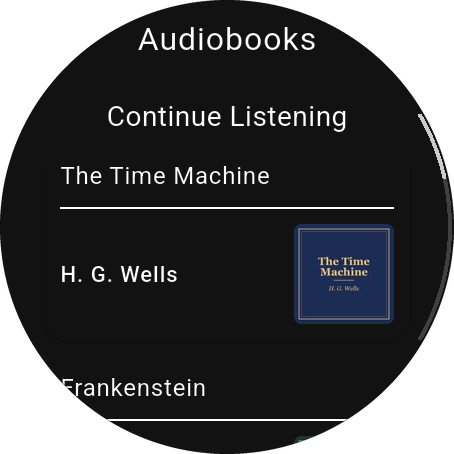
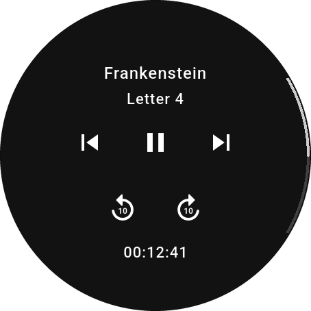
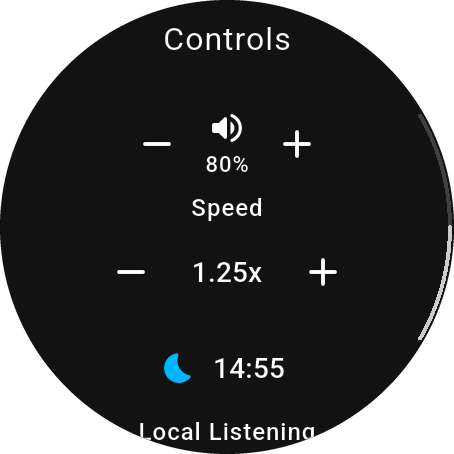
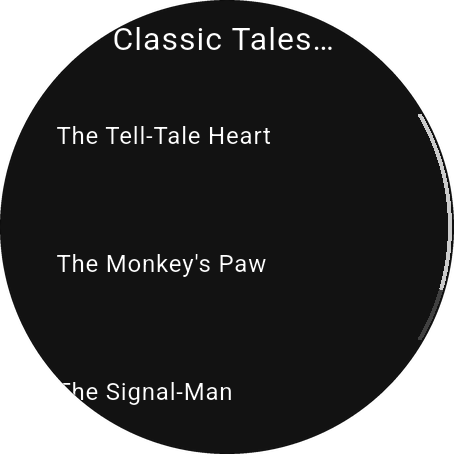

# ABS Wear

![ABS Wear][abs_wear_header]

[![style: very good analysis][very_good_analysis_badge]][very_good_analysis_link]
[![License: MIT][license_badge]][license_link]

[Audiobookshelf][abs_github_link] on your Wear OS watch: a standalone app for listening to your audiobooks and podcasts, no phone needed.

⌚ **[Get ABS Wear on Google Play][play_store_link]** ⌚

<p align="center">
  
  
  
  
</p>

---

## Features

- **Audiobooks and podcasts**: Continue Listening, browse your libraries, switch between them.
- **Stream or download**: download books to the watch and listen offline. Progress syncs when you're back online, and the latest listening wins, on the watch or anywhere else.
- **Player**: chapters, 10-second skips, playback speed, sleep timer and volume.
- **Plays in the background** with media controls, also with the screen off.
- **Downloads** keep going over Wi-Fi with the screen off, with a progress notification you can cancel.
- **Made for the watch**: rotary crown scrolling, ambient mode, large text and screen reader support.
- **18 languages**.

Needs Wear OS 3 or newer and your own [Audiobookshelf][abs_github_link] server.

---

## Installing

The easiest way is [Google Play][play_store_link].

To install a release by hand instead, download the APK for your watch from the [releases page][releases_page]:

- `app-armeabi-v7a-production-release.apk`: most watches, including 32-bit ones like the OnePlus Watch 2.
- `app-arm64-v8a-production-release.apk`: 64-bit ARM watches.
- `app-x86_64-production-release.apk`: the Wear OS emulator.

Then turn on ADB debugging on the watch and install it with [adb][android_platform_tools]:

```bash
adb connect <watch-ip>:<port>   # Wi-Fi debugging; skip when connected by cable
adb install app-armeabi-v7a-production-release.apk
```

---

## Development 🚀

The app has three flavors, each its own app on the watch:

```sh
flutter run --flavor development --target lib/main_development.dart
flutter run --flavor staging --target lib/main_staging.dart
flutter run --flavor production --target lib/main_production.dart
```

### Tests 🧪

```sh
flutter test --coverage --test-randomize-ordering-seed random
```

End-to-end tests run on a watch or emulator against a throwaway Audiobookshelf server. [tool/abs_test_server](tool/abs_test_server) sets it up, including the demo library used for the screenshots above:

```sh
bash tool/e2e.sh <device-id>
```

### Translations 🌐

Strings live in `lib/l10n/arb/` ([flutter_localizations][flutter_localizations_link]). Add a key with a description to `app_en.arb`, add it to every other `app_*.arb` file, and use it with `context.l10n.yourKey`. A test checks that every language has every key.

---

## Special thanks 😊

- [advplyr][advplyr_github_link], author of Audiobookshelf
- [nyxholas][nyxholas_github_link], moderator and contributor of Audiobookshelf

ABS Wear is a third-party app and isn't affiliated with the Audiobookshelf project. Screenshots show a demo library of public-domain titles.

[abs_github_link]: https://github.com/advplyr/audiobookshelf
[abs_wear_header]: .github/pictures/ABS_Wear_header.png
[advplyr_github_link]: https://github.com/advplyr
[android_platform_tools]: https://developer.android.com/tools/releases/platform-tools
[flutter_localizations_link]: https://api.flutter.dev/flutter/flutter_localizations/flutter_localizations-library.html
[license_badge]: https://img.shields.io/badge/license-MIT-blue.svg
[license_link]: https://opensource.org/licenses/MIT
[nyxholas_github_link]: https://github.com/nichwall
[play_store_link]: https://play.google.com/store/apps/details?id=dev.koit.abs_wear
[releases_page]: https://github.com/RasmusKoit/abs_wear/releases/latest
[very_good_analysis_badge]: https://img.shields.io/badge/style-very_good_analysis-B22C89.svg
[very_good_analysis_link]: https://pub.dev/packages/very_good_analysis
